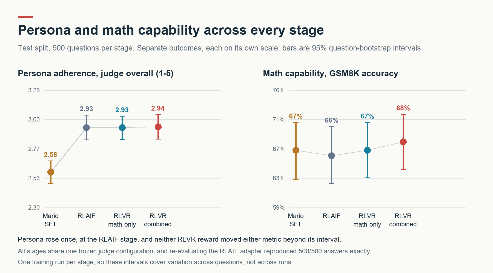
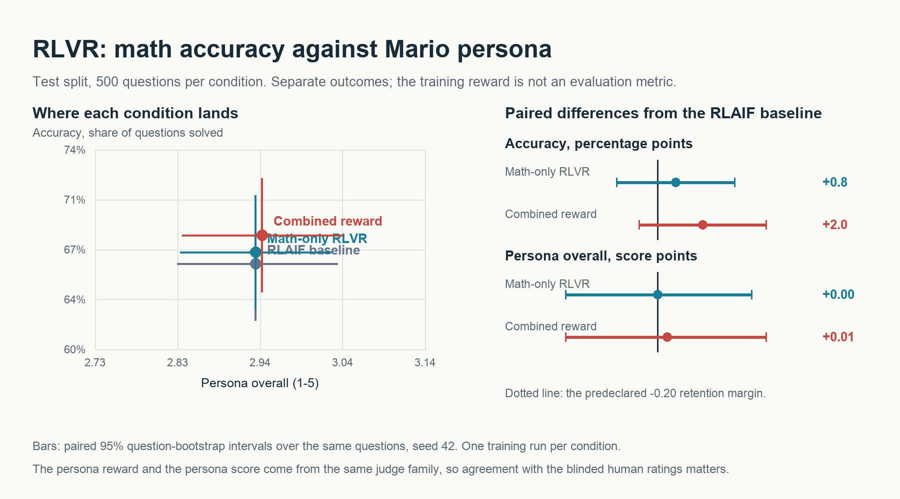

# RLVR results

## Summary

**Persona and math capability stayed independent, and RLVR moved neither.** Across the whole
project, the only stage that changed anything measurable was RLAIF: it raised the judge's
persona score from **2.58 to 2.93 out of 5** on the held-out test set while math accuracy
stayed flat. Continuing with GRPO under a verifiable reward, or under a combined
verifier/persona reward, changed neither metric beyond its confidence interval.

We ran two stage-3 conditions that differ only in the reward, plus the untouched RLAIF model
as a baseline, on 500 validation and 500 test questions. Test accuracy read 66.2% (baseline),
67.0% (math-only) and 68.2% (combined); persona read 2.93, 2.93 and 2.94. Every one of the
eighteen paired comparisons within stage 3 has a 95% interval containing zero.

Against the criteria we fixed before training, this is **accuracy not improved, persona
retained**. The training ran correctly and the reward carried signal, so the result is about
the size of the update budget rather than about the rewards themselves.

## Both metrics across every stage

All four stages were scored by one frozen judge configuration and the same rule-based
verifier, on the same held-out questions.

| Test split | Math capability (verifier) | Persona adherence (judge) | Catchphrase-only | Words |
| --- | ---: | ---: | ---: | ---: |
| Mario SFT | 67.0% | 2.582 | 54.8% | 87 |
| RLAIF | 66.2% | 2.930 | 42.4% | 105 |
| RLVR math-only | 67.0% | 2.930 | 41.2% | 104 |
| RLVR combined (final) | 68.2% | 2.938 | 39.8% | 106 |

| Paired difference, test | Math capability | Persona adherence |
| --- | --- | --- |
| RLAIF minus Mario SFT | -0.8 pp [-4.6, +3.0] | **+0.348 [+0.236, +0.460]** |
| RLVR math-only minus RLAIF | +0.8 pp [-1.8, +3.4] | +0.000 [-0.074, +0.076] |
| RLVR combined minus RLAIF | +2.0 pp [-0.8, +4.8] | +0.008 [-0.074, +0.088] |
| RLVR combined minus Mario SFT | +1.2 pp [-2.4, +4.8] | **+0.356 [+0.248, +0.462]** |

Only the persona gains involving the RLAIF stage exclude zero. Validation agrees: RLAIF minus
Mario SFT is +0.468 [+0.352, +0.582] on persona, and every RLVR contrast spans zero on both
metrics. Accuracy never moves detectably at any stage.



## Persona and capability stayed independent

They neither traded off nor reinforced each other. Persona rose 0.35 points at the RLAIF
stage while accuracy stayed within noise, and end to end — Mario SFT to the final combined
model — persona is up 0.356 [+0.248, +0.462] while accuracy is +1.2 pp [-2.4, +4.8].

We think that is because the two objectives act on separate parts of the answer. The persona
rubric scores voice, consistency, naturalness, and restraint, all properties of how the
explanation is phrased. The verifier reads only the final `####` marker and ignores
everything before it. A model can change its narration substantially without touching the
arithmetic chain that determines correctness, and that appears to be what happened: RLAIF
answers grew from 87 to 105 words and changed register, and solved the same share of problems.

This is an absence of evidence for a trade-off, not evidence of its absence. Our intervals
are about ±2.5 pp wide on paired accuracy, so a real trade-off smaller than roughly 3 points
would not have shown up here. The claim we can defend is that no large trade-off occurred at
this scale of training.

## Did the judge get gamed?

**Not detectably, but the decisive test has not been run.** Three measurable proxies point
away from gaming:

- **Catchphrase-only answers fell rather than rose.** This is the failure mode we were most
  worried about: a model that scores well by stuffing in "It's-a me!" without actually
  responding in character. The rate dropped from 54.8% to 42.4% at the RLAIF stage
  (-12.4 pp [-17.6, -7.0]) and drifted no further during RLVR. A model gaming the rubric this
  way would push that number up.
- **The gain survives length matching.** RLAIF answers are 18 words longer, and length could
  by itself flatter a judge. Restricted to answer pairs within 10% of each other in word
  count, the persona gain over Mario SFT is still +0.179 [+0.022, +0.337] on test.
- **All four rubric dimensions moved together**, rather than one being exploited in isolation.

Two reasons to keep this tentative. The judge that rated these answers comes from the same
family that generated the RLAIF training preferences and the RLVR persona reward, so it is
partly grading its own objective. And the length-matched subset is 184 of 500 questions, a
non-random slice, so it weakens the length explanation without eliminating it.

The decisive check is human review, and it has not happened. We prepared a blinded packet of
[50 questions](rlvr_review/review.md), 150 answers with labels hidden and order randomised per
question, with the key stored separately under provenance. **Until someone rates it, "did the
judge get gamed" is unanswered.** For the RLVR stage specifically the question is close to
moot, because the combined run barely changed the outputs at all.

### How much the judge disagrees with itself

We can put a number on the judge's own reliability, because the RLAIF adapter was evaluated
twice, once in stage 2 and again as the stage-3 baseline. Greedy decoding reproduced
**500/500 answers byte-identically on both splits**, so the same text was rated twice:

| Same 1,000 answers, judged twice | Validation | Test |
| --- | ---: | ---: |
| Shift in mean persona score | -0.022 | +0.000 |
| Per-answer agreement | 93.4% | 94.6% |
| Mean change per answer | 0.110 | 0.092 |

**Every persona difference we measured inside stage 3 is at or below 0.02** — smaller than
the judge's disagreement with itself when re-rating identical text. That is an independent
reason to read those differences as noise, and it is also why the 0.348 RLAIF gain is
credible by contrast: it is more than fifteen times this re-rating drift.

## The three stage-3 conditions

All three share the base model, the frozen RLAIF starting adapter, the same 512 training
questions, sampling settings, seed, and update budget. Only the reward differs.

| Condition | Reward | Judge calls during training |
| --- | --- | ---: |
| RLAIF baseline | none, not trained further | 0 |
| Math-only RLVR | `R = C` | 0 |
| Combined reward | `R = C * (1 + 0.25 * P)` | 1,387 |

`C` is 1 when the strict verifier accepts the final answer and 0 otherwise. `P` is the frozen
rubric's overall score mapped from 1–5 onto 0–1. Because the persona term multiplies
correctness, a wrong answer scores 0 however it sounds, and only correct completions are sent
to the judge. A correct answer earns between 1.00 and 1.25. Both runs started from the RLAIF
adapter independently; the combined run was never initialised from the math-only result.



One detail worth reporting because it is the clearest noise signature in the data: the
combined-minus-math-only accuracy difference is **+1.2 pp on test and -1.2 pp on validation**.
The same comparison, on two splits of the same size, reverses sign.

## Why nothing moved

The run was not broken, and we verified that rather than assuming it.

| Verification | Math-only | Combined |
| --- | --- | --- |
| Adapter tensors changed | 504 | 504 |
| Initial policy/reference KL | 0.00116 | 0.00116 |
| Reference SHA-256 after training | unchanged | unchanged |
| Reference identity | frozen RLAIF copy | frozen RLAIF copy |

Both runs recorded an identical reference hash, confirming they trained against the same
frozen RLAIF model rather than against plain Qwen, and that hash was unchanged afterwards.
The initial KL is under our 0.002 threshold, confirming each policy started at its reference.
All 504 adapter tensors changed, so optimisation happened.

The reward carried real signal too. GRPO learns from differences within a group of four
answers to one question, and groups that are all correct or all wrong teach it nothing:

| Group composition, 512 groups | Math-only | Combined |
| --- | ---: | ---: |
| Mixed correct and wrong | 255 | 245 |
| All four correct | 218 | 215 |
| All four wrong | 39 | 52 |

Half the groups were mixed, far above the pilot gate of 10 that would have stopped the run.
So the explanation is not a degenerate reward. It is the update budget: **32 optimizer steps**,
one pass over 512 questions, at learning rate `1e-6`, with a KL penalty of `0.02` pulling the
policy back toward the reference. Those settings were chosen to be conservative, and they were
conservative enough that the model barely moved.

The persona term had a second, narrower constraint. Within a group, a correct answer outscores
a wrong one by 1.00, while the entire persona bonus spans at most 0.25. Persona can therefore
only steer learning inside the 215 groups where all four answers were already correct, and
only by the spread of ratings across four answers to one question.

## What did not work

- **The conservative hyperparameters, which is the main negative result.** 32 updates at
  `1e-6` under `beta = 0.02` produced no measurable behaviour change from either reward. We
  chose those values to avoid destroying the persona RLAIF had built, and overshot into a
  configuration that could not move anything.
- **Anchoring the KL reference correctly took two attempts.** Given a pretrained adapter,
  TRL 1.13 copies it into a frozen `ref` slot, but older versions instead disable the adapter,
  which silently anchors training to plain Qwen rather than to RLAIF. Our first implementation
  merged a reference copy by hand, which turned out to be unnecessary on the pinned version.
  The script now detects which mechanism is active, refuses to train if the reference would be
  plain Qwen, and records the reference hash before and after.
- **A persona-weight sweep was built and deliberately not run.** We wired up `w ∈ {0.5, 0.75,
  1.0}` ([RLVR_SENSITIVITY.md](../docs/RLVR_SENSITIVITY.md)) before seeing results. Once
  math-only RLVR — which has no persona term at all — also showed nothing, sweeping the
  persona weight looked like four more null results at roughly four times the judge cost.
- **Operational dead ends.** `torch==2.8.0` has been withdrawn from PyPI, so
  `requirements-rlvr.txt` can no longer install it and it has to come from the pod image; the
  script now checks the installed version first instead of failing several minutes into pip.
  An attempt to run the pipeline on Modal was abandoned for the RunPod setup the tooling was
  written for. Judge calls failed locally with `SSLCertVerificationError` until we pointed
  Python at a CA bundle, which surfaced as an opaque "retries exhausted" error.

## How we ran the experiment

Both runs used TRL's GRPO with LoRA, continuing the RLAIF adapter's own weights so each
produced a single adapter over base Qwen. Settings: 512 frozen training questions selected
with seed 42 and audited for overlap against both held-out splits, 4 answers sampled per
question at temperature 1.0 and top-p 0.95, completions capped at 1,024 tokens, learning rate
`1e-6` constant, beta `0.02`, and an effective update of 64 completions covering 16 questions.
That is 32 updates and 2,048 sampled answers per run, on one A100-80GB. We did not change any
of these after seeing results. The combined scalar reward is computed per completion before
GRPO forms group advantages, and standard-deviation reward scaling is off, so correctness and
persona are never normalised apart.

For evaluation we ran every adapter with the same Qwen2.5-3B-Instruct revision, neutral system
prompt, and greedy decoding, including a freshly re-evaluated RLAIF baseline. Haiku 4.5
(`claude-haiku-4-5-20251001`) scored all 3,000 stage-3 answers with the same frozen rubric used
during training, seeing each question and answer without the model label or gold answer. The
stage-2 ratings reused here carry the same judge configuration hash.

The only evaluation setting that differs between the stage-2 and stage-3 sessions is the torch
build tag (`2.8.0` versus `2.8.0+cu128`); model, revision, prompt, decoding, and code hashes
all match, and the byte-identical RLAIF outputs confirm the difference had no effect.

Confidence intervals come from resampling question pairs 10,000 times with seed 42. Judge
spending was $2.83 during combined training and $6.16 for the evaluation ratings, $8.99 total,
tracked on two separate ledgers so each had its own cap.

## Limits

- **One training run per stage.** Every difference reported here is within the range a
  different seed could plausibly produce, and the sign flip between splits suggests it is.
  These intervals cover variation across questions, not across runs.
- **The judge scored what it trained.** The persona reward and the persona metric come from
  the same judge family. The blinded human review is the check on that, and it is not done.
- **Limited resolution.** The paired accuracy intervals are about ±2.5 pp wide, so a real
  improvement smaller than roughly 3 pp would not have been distinguishable from noise.
- **The training reward is not an evaluation metric.** The combined run's mean training reward
  of 0.763 is not comparable to the math run's 0.704; they are on different scales.

## Conclusion and next step

Persona and capability stayed independent across all three stages. RLAIF bought a 0.35-point
persona gain at no measurable cost to math, and RLVR added nothing to either metric under
either reward. The experiment was executed as planned and verified sound, so the finding is
about the training budget rather than about the reward design.

The informative next step is not varying the persona weight. Math-only RLVR contains no
persona reward and also failed to move accuracy; until a verifiable reward alone can shift the
model at this scale, the shape of the persona term is a second-order question. Raising the
update count or the learning rate, or lowering `beta`, and re-running the same two-condition
comparison would tell us more. The pilot gate, frozen question set, and matched evaluation all
carry over unchanged.

The remaining check on this run is for people to rate the [50 blinded questions](rlvr_review/review.md),
since the automated judge both trained and evaluated the combined condition.

The [saved outputs](../results/rlvr/), [judge scores](../results/rlvr/judge/), [training
records](../provenance/rlvr/), and [runbook](../docs/RLVR.md) are in the repository.

<details>
<summary>Reproduce the tables and figures without a GPU or API call</summary>

```bash
python analyze_rlvr.py summarize          # the three stage-3 conditions
python analyze_rlvr.py stages             # all four stages, derived/rlvr/stages.json
# Requires Pillow.
python analyze_rlvr.py plot
python analyze_rlvr.py stage-plot
```

</details>
