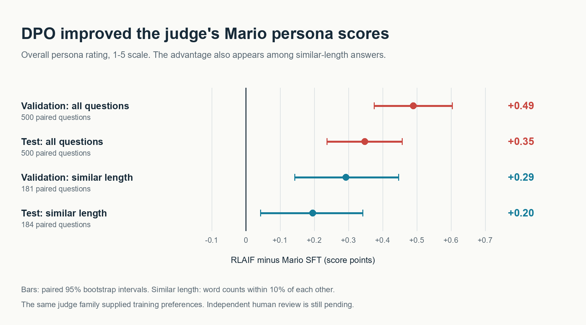

# RLAIF results

## Summary

After DPO training, the model earned higher Mario persona ratings, with no clear change in math accuracy. On 500 test questions, its persona score rose from **2.58 to 2.93 out of 5**. Math accuracy fell from 67.0% to 66.2%, but we could not distinguish that difference from sampling variation.

These persona ratings come from an automated judge. We used the same judge family to create the training preferences, so human review is still needed to check whether people agree. Below, we compare persona and math results, then describe the experiment and its limits.

## Persona improved under the judge

We compared the Mario SFT model with the same model after DPO training, labeled RLAIF. Haiku 4.5 rated both models' answers on 500 validation and 500 test questions. Higher scores are better.

| Overall persona score (1-5) | Mario SFT | RLAIF | Change [95% confidence interval] |
| --- | ---: | ---: | --- |
| Validation | 2.632 | 3.122 | +0.490 [0.376, 0.604] |
| Test | 2.582 | 2.930 | +0.348 [0.238, 0.458] |

Both intervals stay above zero, supporting a gain under this judge. On test, RLAIF scored higher on 154 questions, tied on 278, and scored lower on 68. The validation counts were 175, 273, and 52.

The judge also flagged fewer answers as relying only on catchphrases. This addresses our concern that the model might add Mario phrases without responding to the problem in character.

| Catchphrase-only answers (lower is better) | Mario SFT | RLAIF | Change [95% confidence interval] |
| --- | ---: | ---: | --- |
| Validation | 55.8% | 37.0% | -18.8 pp [-24.0, -13.4] |
| Test | 54.8% | 42.2% | -12.6 pp [-18.0, -7.2] |

Here and below, "pp" means percentage points. All four supporting rubric scores improved as well:

| Rubric score (1-5) | Validation SFT | Validation RLAIF | Test SFT | Test RLAIF |
| --- | ---: | ---: | ---: | ---: |
| Voice | 2.664 | 3.144 | 2.614 | 2.968 |
| Consistency | 2.664 | 3.154 | 2.622 | 2.980 |
| Naturalness | 2.462 | 2.934 | 2.394 | 2.754 |
| Restraint | 2.674 | 3.054 | 2.618 | 2.882 |

RLAIF wrote longer answers: 100 versus 86 words on validation and 105 versus 87 on test. To check whether length might explain the gain, we compared answers whose word counts differed by no more than 10%.

| Similar-length answers | Question pairs | Persona score change [95% confidence interval] |
| --- | ---: | --- |
| Validation | 181 | +0.293 [0.144, 0.448] |
| Test | 184 | +0.196 [0.043, 0.342] |

The gain remained, though it was smaller. This check does not rule out length bias because it includes only a subset of questions.



## Math showed no clear change

| GSM8K accuracy | Mario SFT | RLAIF | Change [95% confidence interval] |
| --- | ---: | ---: | --- |
| Validation | 75.2% (376/500) | 76.6% (383/500) | +1.4 pp [-2.4, +5.4] |
| Test | 67.0% (335/500) | 66.2% (331/500) | -0.8 pp [-4.6, +3.0] |

Validation accuracy rose and test accuracy fell. Both intervals include zero. We cannot conclude that DPO improved or harmed math accuracy, nor that it preserved accuracy exactly.

Text similarity to the Mario reference answers also showed no clear change:

| Validation text similarity | Mario SFT | RLAIF | Change [95% confidence interval] |
| --- | ---: | ---: | --- |
| Full answers | 0.4000 | 0.4015 | +0.0015 [-0.0042, +0.0072] |
| Math masked | 0.4228 | 0.4224 | -0.0004 [-0.0057, +0.0048] |

Text similarity measures shared wording. The rubric judge rates character voice. The two measures gave different results here; neither replaces human review.

## How we ran the experiment

We trained the Mario SFT adapter with Direct Preference Optimization (DPO) on 773 judge-ranked answer pairs. Both answers in every pair had the correct numeric answer, so the preferences targeted persona rather than final-answer correctness. We kept the original SFT model as the frozen reference.

Training used one epoch, 49 optimizer steps, learning rate `5e-6`, beta `0.1`, effective batch size 16, and seed 42. We did not change these settings after seeing the evaluation results.

For evaluation, we ran both adapters with the same Qwen2.5-3B-Instruct revision, software environment, neutral system prompt, and greedy decoding. We reran Mario SFT for this comparison; its older report used a different environment.

Haiku 4.5 (`claude-haiku-4-5-20251001`) scored all 2,000 answers with the same rubric and API settings. It saw each question and answer, without the model label or gold answer. These scores are not directly comparable with the older Claude Code batch ratings, which used a different setup.

We calculated confidence intervals by resampling question pairs 10,000 times with seed 42. They capture variation across questions, not across training runs; we trained only one adapter. For text similarity, we used character 3-5 gram TF-IDF fitted on the Mario training answers and compared each validation output with its same-question reference.

The estimated costs were $4.08 for judging and $0.98 for GPU time, excluding storage and billing adjustments. [Training records](../provenance/training/rlaif/README.md) and [judge records](../provenance/judge/rlaif-api/README.md) contain the operational details.

## Conclusion and next step

DPO raised the automated persona score and reduced catchphrase-only answers. We found no clear change in math accuracy. The remaining step is to have people rate the [50 blinded answer pairs](persona_review/review.md), since the automated judge also supplied the training preferences.

The [adapter instructions](../adapters/README.md#rlaif-adapter), [saved outputs](../results/), [judge scores](../results/judge/), and [evaluation protocol](../docs/PERSONA_EVALUATION.md) are available in the repository.

<details>
<summary>Reproduce the tables and figure without a GPU or API call</summary>

```bash
python prepare_data.py
pip install scikit-learn==1.7.2
python compare.py --rlaif --split val --output-dir derived/comparisons/rlaif
python compare.py --rlaif --split test --output-dir derived/comparisons/rlaif
python evaluate_persona.py summarize
# Requires Pillow.
python evaluate_persona.py plot
```

</details>
